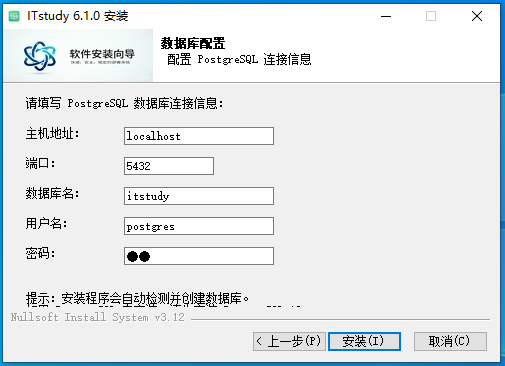

# ITstudy V6.1.1 · 学科教学及测试平台

> **一句话介绍**：ITstudy 是一个装在**学校机房或局域网**里的教学平台。
> 老师用浏览器上传资料、布置作业、组织考试；学生用浏览器学习、答题、交作业；
> 管理员用浏览器建班级、管账号、看数据。**老师和学生都不用安装任何软件。**

当前版本：`V6.1.1` ｜ 适用场景：学校机房、校园局域网、单机试用
版权：Copyright (C) 2025-2026 YINJUN，仅供个人学习使用，不得商用。

---

## 目录

- [一、介绍](#一介绍)
- [二、软件架构](#二软件架构)
- [三、安装教程](#三安装教程)
  - [3.1 安装前准备](#31-安装前准备)
  - [3.2 安装 PostgreSQL 并记下 5 个信息](#32-安装-postgresql-并记下-5-个信息)
  - [3.3 安装 ITstudy](#33-安装-itstudy)
  - [3.4 第一次登录](#34-第一次登录)
- [四、使用说明](#四使用说明)
  - [4.1 学生怎么用](#41-学生怎么用)
  - [4.2 老师怎么用](#42-老师怎么用)
  - [4.3 管理员怎么用](#43-管理员怎么用)
  - [4.4 备份（很重要）](#44-备份很重要)
  - [4.5 升级与卸载](#45-升级与卸载)
  - [4.6 常见问题](#46-常见问题)
- [五、参与贡献](#五参与贡献)
- [六、特色功能（“特技”）](#六特色功能特技)
- [七、文档与版本](#七文档与版本)

---

## 一、介绍

ITstudy 把日常教学里最常做的事都搬到了网页上：

- **在线考试**：题库/试卷解耦、按题型组卷、自动判分、教师批改、成绩趋势与导出。
- **学习资源**：课件/资料/视频在线预览，支持外部链接、对学生隐藏、课堂页。
- **作业**：布置、提交、批改、评价、打包优秀作品。
- **在线课堂**：章节目录、视频/PPT 播放、黑板、画笔、倒计时、点名、思维导图。
- **个人网盘 / 小组网盘**：学生存放文件，老师可查看与发送文件。
- **仿真实验**：化学仿真、硬件仿真、GeoGebra，全部使用本地资源。
- **AI 助手**：接入自己的 AI 接口答疑，可限定学生只围绕当前页面内容提问。

**三种人用同一个平台，各有各的登录入口：**

| 谁 | 登录地址（本机部署） | 主要能做什么 |
|----|----------------------|--------------|
| **学生** | `http://localhost:5000/` | 看资料、考试、交作业、传作品、用网盘 |
| **教师** | `http://localhost:5000/teacher/login` | 管资源、发作业、批改、组卷、上课 |
| **管理员** | `http://localhost:5000/admin/login` | 建班级/账号、排课、系统设置、备份 |

> 装好后，把 `localhost` 换成服务器的 IP 或域名发给老师和学生即可，
> 例如 `http://192.168.1.100:5000/`。

**账号从哪来？**

- 管理员：安装时自动创建，初始密码在 `admin_account.initial.txt`（见 3.4）。
- 教师：管理员登录后，在「教师账号」页创建。
- 学生：管理员或教师批量导入（支持 Excel）。

---

## 二、软件架构

### 2.1 总体结构（一张图看懂）

```text
┌─────────────────────────────────────────────────────────────┐
│ 浏览器                                                      │
│   学生端（/）      教师端（/teacher）      管理端（/admin、/app） │
└───────────────────────────┬─────────────────────────────────┘
                            │ HTTP / HTTPS
┌───────────────────────────▼─────────────────────────────────┐
│ Nginx（可选）                                                │
│   静态资源直服 · HTTPS · 反向代理 · 上传目录代理回应用          │
└───────────────────────────┬─────────────────────────────────┘
                            │
┌───────────────────────────▼─────────────────────────────────┐
│ Waitress + Flask（单进程多线程）                              │
│  ├─ 页面与路由：Jinja2 模板 + SPA（/app）                     │
│  ├─ 业务模块：资源、作业、考试、课堂、网盘、问卷、AI、日志…     │
│  ├─ 权限：学生资源范围、教师任课范围、文件级隐藏、CSRF、限流     │
│  └─ 缓存/压缩：Flask-Caching、flask-compress、预压缩 .gz        │
└───────────────┬─────────────────────────────┬───────────────┘
                │ SQLAlchemy                  │ 本地文件
┌───────────────▼──────────────┐  ┌───────────▼───────────────┐
│ PostgreSQL                   │  │ static/uploads（资源/网盘） │
│ 学生、成绩、作业、资源记录…   │  │ static/homework（作业附件） │
└──────────────────────────────┘  │ static/submissions（提交）  │
                                  │ static/question_img（题目图）│
                                  └───────────────────────────┘

本地仿真资源（不依赖公网）：
  static/chem-lab/     化学仿真（Ketcher/OpenChemLib/3Dmol/Molstar）
  static/geogebra/     GeoGebra 5.4.934 完整引擎
  static/hardware-sim/ 掌控板 + ESP32-S3 仿真
  static/three/        上传课件使用的 three.js 本地副本
```

### 2.2 技术栈

| 层次 | 技术 | 用途 |
|------|------|------|
| 后端 | Flask 3.x + Waitress | Web 应用与生产 WSGI 服务 |
| 数据 | Flask-SQLAlchemy + Flask-Migrate + PostgreSQL | 数据模型、迁移与业务数据存储 |
| 缓存 | Flask-Caching（默认单进程 `SimpleCache`） | 高频查询缓存；多进程可切 `FileSystemCache` 或 Redis |
| 压缩 | flask-compress | gzip / brotli 响应压缩 |
| 页面 | Jinja2 + Bootstrap 5 + FontAwesome + Chart.js | 三端页面、组件与统计图表 |
| SPA | `frontend/`（免构建 Vue 3） | `/app` 管理端界面 |
| 文档预览 | JitViewer | PDF、Office、OFD、Markdown、代码、图片等在线预览 |
| 在线 PPT | PPTist | PPTX 导入、编辑、放映 |
| 打包 | NSIS | Windows 安装包 |

### 2.3 目录结构

```text
ITstudy/
  app.py                  应用入口（生产用 itstudy_service.py 或 run_zh.bat）
  itstudy_service.py      Windows 服务入口
  run_zh.bat              本地一键启动
  requirements.txt        Python 依赖
  constraints.txt         钉死的依赖版本（离线安装/容器共用）
  app/                    Flask 应用（模型、路由、服务层）
  templates/              Jinja2 页面模板
  static/                 静态资源与业务上传文件
  frontend/               SPA 管理端（入口 /app）
  migrations/             数据库迁移
  docs/                   文档与部署样例
  pack/                   安装包构建脚本与素材
  tests/                  pytest 回归测试
  tools/                  维护工具（压缩、归档、密码重置等）
  data/                   运行期缓存（可删除，自动重建）
  logs/                   运行日志（app.log）
  instance/               运行期配置（secret_key、deploy.conf，自动生成）
```

> `data/`、`logs/`、`instance/`、`venv/`、`__pycache__/`、`.pytest_cache/` 是本机运行/测试产物，
> 删除后会自动重建，不属于交付文件。

### 2.4 关键设计

- **三端同源**：学生、教师、管理员共用一套 Flask 应用和数据库，用不同入口与权限区分。
- **权限范围**：学生资源范围 = 任课教师范围 + 公开/内置资源；教师只能管理自己创建或
  被授权的资源；文件级「展示」隐藏对所有人生效。
- **上传文件不裸奔**：网盘、作业、提交目录按账号与班级鉴权；Nginx 必须把上传目录代理回应用。
- **课件沙箱**：上传 HTML 课件默认在 opaque sandbox 中运行，不能读取平台 Cookie 或调用同源 API；
  需要同源能力的平台自有页面按来源单独放行。
- **离线优先**：化学仿真、GeoGebra、硬件仿真、three.js 等资源随包分发，不依赖公网；
  前端依赖按「本地 → 国内镜像 → 官方 CDN」逐级回退。
- **大文件友好**：上传分块 + 断点续传；下载支持 Range；大附件走专用下载池，避免拖慢整站。
- **可观测**：慢 SQL（>500ms）、慢页面（>800ms）写入日志；管理端有部署检查清单与账号轨迹。

---

## 三、安装教程

### 3.1 安装前准备

ITstudy 需要两样东西：

| 需要什么 | 版本 | 干什么用 | 必须装吗 |
|----------|------|----------|----------|
| **Python** | 3.10 或更高 | 运行 ITstudy 本体 | 是（安装包会自动建虚拟环境） |
| **PostgreSQL** | 12 或更高 | 存所有数据（学生、成绩、作业……） | 是 |

> Node.js、NSIS 只在“自己重新打安装包”时才需要，普通安装可以完全不管。

### 3.2 安装 PostgreSQL 并记下 5 个信息

PostgreSQL 的下载、安装、改密码、建库步骤见
**[PostgreSQL 安装指南](docs/postgresql-guide.md)**。

安装时请把下面 5 项**抄在纸上或记事本里**，安装 ITstudy 时会原样填进去：

| 要记录的信息 | 常见值 | 说明 |
|---|---|---|
| **主机地址** | `localhost` | 数据库装在哪台电脑；本机就填 `localhost` |
| **端口** | `5432` | PostgreSQL 默认端口，没改过就是 5432 |
| **数据库名** | `itstudy` | 安装程序会自动创建，不用手动建 |
| **用户名** | `postgres` | PostgreSQL 的超级管理员账号 |
| **密码** | **你自己设置的密码** | 安装 PostgreSQL 时设置的密码，**最需要记住** |



> 上图就是 ITstudy 安装向导里的“数据库配置”窗口。提前把 5 项记好，
> 安装时照着填即可。数据库不用你提前创建，安装程序会自动检测并建库。

**确认 PostgreSQL 在运行**：打开 PowerShell，执行：

```powershell
pg_isready -h localhost -p 5432
```

看到 `accepting connections` 就说明数据库在线。如果提示找不到命令，
说明 PostgreSQL 的 `bin` 目录没加入 PATH，见
[PostgreSQL 指南 · 添加 PATH](docs/postgresql-guide.md#三把-postgresql-加入-path命令不可用时才做)。

### 3.3 安装 ITstudy

三种方式装出来的功能是一样的，按你的情况选一种。

#### 方式 A：Windows 安装包（推荐给不熟悉命令行的老师）

**这一步在干嘛**：双击一个 exe，按向导点“下一步”，装完自动把服务跑起来。

1. 双击 `ITstudy-v6.1.1-Setup.exe`。
2. 按向导依次完成：欢迎 → 环境检测 → 同意许可 → 选择安装目录
   → **填写数据库连接信息**（就是 3.2 记下的 5 项）。
3. 等待安装程序复制文件、创建虚拟环境、安装依赖（第一次较慢，需要联网）。
4. 安装完成后，ITstudy 会注册成 **Windows 服务**并自动启动，以后开机也会自己起来。
5. 浏览器打开 `http://localhost:5000/`，看到学生登录页就成功了。

> **安装给很多台机器**：安装包支持静默安装：
> ```powershell
> ITstudy-v6.1.1-Setup.exe /S /PGNAME=itstudy /PGPASS=你的数据库密码
> ```
> 更多封装细节见 [pack/封装说明.md](pack/封装说明.md)。

#### 方式 B：直接在项目文件夹里运行（已有 Python，想快速试一下）

**这一步在干嘛**：项目自带“一键启动”脚本，会检查环境、建虚拟环境、装依赖、
建库建表，然后启动。

1. 确认 Python 和 PostgreSQL 都装好了（3.1～3.2）。
2. 在项目根目录**双击 `run_zh.bat`**（或在命令行运行它）。
3. 等它完成 7 个步骤：检测 Python → 检测 PostgreSQL → 检测 Node.js（缺失只提示）
   → 安装依赖（第一次会创建 `venv`，稍慢）→ 执行数据库迁移 → 启动 Waitress。
4. **成功的标志**：命令行窗口停在那儿不退出；浏览器打开 `http://localhost:5000/`
   能看到学生登录页。

> 熟悉命令行的也可以手动启动：
> ```powershell
> python -m venv venv
> .\venv\Scripts\activate
> pip install -r requirements.txt
> python app.py
> ```
> 但**日常/正式使用请用 `run_zh.bat`**；`python app.py` 只是单线程调试服务器，并发能力差。

#### 方式 C：Docker 容器（装在 Linux 服务器上）

**这一步在干嘛**：把 ITstudy 和数据库一起放进 Docker 运行，适合服务器部署。

一句话启动（详细说明见 [容器部署指南](docs/容器部署.md)）：

```bash
DB_PASS='你的数据库强口令' \
SECRET_KEY='一串随机字符' \
ADMIN_INIT_PASSWORD='初始管理员口令' \
  docker compose up -d --build
```

> 容器方式默认走 `8000` 端口（不是方式 A/B 的 `5000`），注意区分。

### 3.4 第一次登录

**这一步在干嘛**：拿到管理员账号，进去建老师、建学生。

#### 管理员初始密码在哪？

系统不使用 `admin/admin123` 这种弱默认密码。第一次启动时会**随机生成一个密码**，
并输出到下面两处（任选一处查看）：

- **启动窗口（控制台）**：用 `run_zh.bat` 启动时直接看窗口；
  Docker 部署看 `docker compose logs app`。
- **`admin_account.initial.txt` 文件**：在项目根目录；
  Windows 安装包默认在 `C:\Program Files\ITstudy\`。
  **以 Windows 服务方式运行时没有可见控制台，请打开这个文件查看密码。**

这个提示文件是**一次性的**：第一次用管理员账号登录成功后会自动删除。
请马上记下来，并在登录后第一件事去 **系统 → 管理员账号** 改成自己记得住的密码。

> - 安装前可用环境变量 `ADMIN_INIT_PASSWORD=你的密码` 预先指定初始密码
>   （指定后不会随机生成，也不会产生提示文件）。
> - **密码忘了**：在项目目录运行 `python tools/reset_admin_password.py` 重置。

#### 三个入口

| 入口 | 地址 | 账号来源 |
|------|------|----------|
| 学生端 | `http://localhost:5000/` | 管理员/教师创建或批量导入 |
| 教师端 | `http://localhost:5000/teacher/login` | 管理员在「教师账号」页创建 |
| 管理端 | `http://localhost:5000/admin/login` | 见上文“管理员初始密码在哪” |
| 管理端 SPA | `http://localhost:5000/app` | 另一种管理界面（同一套账号） |

> 配置了 Nginx 反向代理时，端口换成 Nginx 的端口（示例是 `8081`），见
> [技术参考 · Nginx 反向代理](docs/技术参考.md#四nginx-反向代理完整-8-步)。

#### 几个“第一次”规则

- **管理员可以有多个账号**：登录后进 **系统 → 管理员账号**，可添加、改密、停用/启用、删除。
  不能停用/删除当前登录的自己，且至少保留一个启用中的管理员。
- **学生首次登录必须改密码**：用批量导入发的共享初始密码登录后，会被要求先改密码。
- **学生登录受“当前上课班级”限制**：管理员设好上课班级后，该班学生才能登录；
  班级停用或切换到其他班后，学生会话失效。
- **同一时段可多个上课班级**：课程表同一节次可追加多个班级；大屏顶部可切换查看，
  每个班有独立签到、座位偏移和展示消息。

---

## 四、使用说明

### 4.1 学生怎么用

登录后可以：

- 在**学习资源**里看老师上传的课件、视频、资料；
- 参加**在线考试**（注意倒计时）、查看并提交**作业**；
- 在**个人网盘**存取文件，参加**学习小组**；
- 参加学习活动、上传作品；
- 打开**仿真实验**：化学仿真、硬件仿真、GeoGebra 等；
- 向 **AI 助手**提问（如果老师开了“AI 仅限本页”，它只回答当前页面相关内容）。

导航栏的「今日学习」会汇总当前课堂、今日任务、学习路径和最近反馈。

### 4.2 老师怎么用

**登录模式**：教师登录页默认勾选「只读模式」。只读模式只能进课堂使用自己创建及
被授权的资源，不能编辑、批改或查看学生隐私；取消勾选并用密码登录，进入**编辑模式**。

**教学台**：登录后默认进入 `/teacher/dashboard`，汇总今日课程、当前节次、
正在上课的班级，以及进入课堂、课堂大屏、仿真实验的快捷入口。

常用功能：

- **资源管理**：上传课件/资料（大文件自动分块、断点续传）、挂外部链接、
  设置“对学生可见/隐藏”；创建者可编辑/删除自己的资源，并可授权其他教师只读使用。
  编辑模式下「资源管理 → 添加外链」可直接把外部网址建成资源，支持课内打开、
  课堂使用与新窗口登录跳转；只读模式只能查看。
- **个人课程表**：编辑模式在「设置 → 作息/课表」为自己任课班级添加/删除课程安排，
  同一节次可添加多个班级；只读模式只能查看管理员维护的作息和本人班级课表。
- **作业**：发布作业与附件、查看提交、批改、评价、打包优秀作品。
- **考试与批改**：从题库组卷（按题型选、自动汇总总分），学生考完在**批改中心**
  改主观题；成绩趋势与导出。
- **在线课堂**：打开资源的课堂页，有章节目录、视频/PPT 播放、黑板、画笔、
  倒计时、点名、思维导图等；切换文档/PPTX/网页后会恢复上次阅读位置。
- **AI 配置**：编辑模式可在「教学资源 → AI 配置」填写自己的 API 地址/密钥/模型；
  可确认是否保存到数据库；可勾选任教班级，把配置共享给该班学生。
  只读模式固定使用管理员配置。
- **化学仿真 / 硬件仿真 / GeoGebra**：导航栏「仿真实验」统一入口；
  化学仿真全程离线，GeoGebra 使用随包本地引擎。
- **学生网盘 / 教学记录**：查看学生网盘、给学生发文件；上课/下课打卡。

#### 让自制网页自动交成绩（进阶，给会做网页的老师）

如果你有自己做的 HTML 测验页，可以上传为学习资源，让成绩自动汇总到管理端：

1. 上传 HTML 资源时选择「注入采集」，并勾选需要采集的文件；
2. 保存后进入「注入检测」页，点「开始模拟」，在演练页完成一次答题并提交；
3. 检测显示「通过」后，点「应用已通过的文件」，才会把采集脚本写入原 HTML；
4. 如果只抓到答案没有成绩，会显示「仅答案」，需要二次确认；
5. 显示「无法注入」时原文件不变，可改用 QuickForm 链路。

> 成绩是学生浏览器自己报上来的（判分在网页里），系统只做范围校验、无法重判；
> 管理端会标“未核实”，**不要用于竞赛评奖**等严谨场景。需要防作弊请用系统在线考试。

页面结构特殊时，可在判分完成时设置：

```html
<script>
  window.ITSTUDY_QUIZ_GRADE = '优秀';        // 等级，字符串
  window.ITSTUDY_QUIZ_CORRECT = 8;           // 答对题数，必须是数字
  window.ITSTUDY_QUIZ_TOTAL_QUESTIONS = 10;  // 总题数，必须是数字
</script>
```

题数两项必须赋**数字**（`8`），写成字符串（`'8'`）会被忽略。

### 4.3 管理员怎么用

**第一次使用，按这个顺序初始化：**

1. **建班级**：「班级与考勤 → 班级信息」新建班级（班级名称是后续导入、课表、大屏的匹配键）。
2. **建教师账号**：「教师账号」创建教师，必须分配学科、年级和任课班级。
3. **导入学生**：「学生信息 → 批量导入」支持 Excel 和文本。下载模板后按
   `学号 / 姓名 / 班级 / 年级` 填写；**年级建议与教师账号的年级一致**
   （如高一、高二、高三），否则按年级授权的资源可能匹配不到。导入后会生成统一
   临时密码，学生首次登录必须修改。
4. **上传资源**：管理员统一上传，或让教师在自己的资源管理里上传/添加外链。
5. **课程表（可选）**：管理员可在「班级与考勤 → 课程表」统一配置；教师编辑模式
   也可在「作息/课表」为自己任课班级添加。**没有课程表也能手动开启课堂**，
   不是必须项。

登录管理端后，最常用的还有 **系统开关** 和 **系统设置**：

- **学生端访问**：一键“维护模式”。关闭后学生登录/资料/作业/考试显示“维护中”，
  不影响老师和管理员。
- **管理员远程登录**：默认关闭（只有服务器本机可登录管理端）；需要远程管理时再打开。
- **课件公开访问**：默认开启（未登录也能看 `/study` 与课件）；关闭后仅登录用户可见。
- **成绩公布**：每张试卷单独控制；关闭时学生看不到分数（包括“待批改”）。
- **AI 对话**：在「AI 配置」页统一填接口；「学生限本页」开启后，学生 AI 只能围绕
  当前页面内容作答，老师/管理员自己的对话不受限。
- **仿真实验中心**：`/sim-lab` 是化学仿真与硬件仿真的统一入口，
  `/chem-lab`、`/hardware-sim` 仍可直接访问。
- **账号轨迹**：`数据与审计 → 账号轨迹` 查看登录时间/IP、退出时间、页面访问，
  支持多终端并列、筛选与单条/批量删除。

### 4.4 备份（很重要）

**一句话**：**备份 = 数据库 + 磁盘文件，两部分都要**。
只备份数据库，恢复后上传的附件、图片、作业会丢失。

**① 数据库备份**（在装了 PostgreSQL 的机器上执行）：

```powershell
pg_dump -h localhost -p 5432 -U postgres -d itstudy --no-owner --no-acl > backup.sql
```

**② 文件备份**：把下面这些目录/文件整个复制走：

- `static/uploads/` —— 学习资源、网盘文件、Python 文件
- `static/homework/` —— 作业附件
- `static/submissions/` —— 学生提交的文件
- `static/question_img/` —— 题目图片
- `instance/secret_key` —— 会话密钥（**丢了所有人要重新登录**）
- `admin_account.txt` —— 管理员账号文件
- `admin_account.initial.txt` —— 首次登录前的一次性密码提示（登录成功后自动删除，可忽略）

**③ 恢复**（建议先停掉 ITstudy 服务）：

```powershell
psql -U postgres -d itstudy < backup.sql
```

恢复后抽查一条作业附件和网盘文件能否下载；若提示“会话失效”，
多半是 `instance/secret_key` 没一起恢复。

> 容器部署的备份方式不同（要备份数据卷），见 [容器部署指南](docs/容器部署.md)。

### 4.5 升级与卸载

**升级**：**再运行一次安装包**即可。安装器会停掉旧服务、覆盖程序文件、重启服务；
**数据库结构和数据会保留**（应用启动时自动补齐新增的表和字段）。

> **V6.1.0 升级注意**：铜匠实验室已移出内置资源，升级迁移会**删除**旧
> 「铜匠实验室」资源行及其关联的上课记录、活动、问卷与授权
> （不备份、不可恢复）。如需保留请先在管理端导出。

**卸载**：

- 在“控制面板 → 程序和功能”里卸载，或静默卸载：

  ```powershell
  "C:\Program Files\ITstudy\uninst.exe" /S               # 默认保留运行数据
  "C:\Program Files\ITstudy\uninst.exe" /S /DELDATA=1    # 连运行数据一起删
  ```

- 卸载器会停掉并注销 Windows 服务、删除安装目录、清掉快捷方式和注册表项。
- 选择**保留运行数据**时，`instance`、`data`、`static` 会保留；
  真实上传数据在 `static/uploads`、`static/homework`、`static/submissions`、
  `static/question_img`，重装后无损。
- **数据库不会被卸载器删除**（即使加了 `/DELDATA=1`）。确实要删库需手动执行：

  ```sql
  DROP DATABASE IF EXISTS itstudy;
  ```

  卸载后安装目录里的 `postgresql.txt`（连接信息）也会一起删除，想事后删库请先留好连接信息。

### 4.6 常见问题

| 症状 | 常见原因和解决办法 |
|------|--------------------|
| 打不开页面 / 服务起不来 | 先看 PostgreSQL 服务是否运行；再看 `logs/app.log`；Windows 还可看“事件查看器” |
| 学生登录不上 | 是否已设“上课班级”；学生是否被停用；学号前后有没有空格 |
| 管理员密码忘了 | 项目目录执行 `python tools/reset_admin_password.py` |
| 数据库密码忘了 | 见 [PostgreSQL 指南 · 忘记密码](docs/postgresql-guide.md#七忘记-postgres-密码怎么办) |
| 页面能开但样式/图片全丢 | Nginx 的 `/static/` 必须用 `root`（不能用 `alias`），指向实际安装根目录；改完 `nginx -s reload` |
| 8081 返回其他站点 | `server_name` 没包含当前访问地址，或同端口有其他 server 块 |
| 上传的文件打不开 | 上传目录被 Nginx 绕过；`/static/uploads/`、`/static/homework/`、`/static/submissions/`、`/static/chunks/` 必须代理回应用 |
| 大文件传不上去 | Nginx `client_max_body_size`、应用单请求上限、功能单文件上限三层都要够；超大文件用分块上传 |
| 端口 5000 被占用 | `netstat -ano | findstr :5000` 查占用程序，换端口或先停掉它 |
| 依赖报缺包 | `pip install -r requirements.txt`；离线安装同时带 `-c constraints.txt` |
| 日志报 `No module named 'psycopg'` | 升级到当前安装包，或在安装目录执行 `venv\Scripts\python.exe -m pip install "SQLAlchemy>=2.0,<2.1" "psycopg2-binary>=2.9,<3.0"` 后重启服务 |

**日志在哪看**：项目目录下的 `logs/app.log`（自动滚动，单文件 10MB、最多 10 个）。
单条 SQL 超过 500ms 会记 `[SLOW SQL]`；动态页面超过 800ms 会记“慢页面请求”。

**进阶**：Nginx/HTTPS、部署调优参数、性能建议见 [技术参考](docs/技术参考.md)；
让局域网其他电脑访问：确认监听 `0.0.0.0:5000`，在防火墙放行端口，其他电脑访问
`http://服务器IP:5000/`。

---

## 五、参与贡献

ITstudy 目前是个人学习项目，欢迎提交问题反馈、改进建议和代码贡献。

### 5.1 开发环境

```bash
python -m venv venv
venv\Scripts\pip install -r requirements.txt
run_zh.bat
```

### 5.2 提交前自检

```bash
# 全量回归（使用独立测试库 itstudy_test，不会污染生产数据）
venv\Scripts\python -m pytest tests/ -q

# 测试库残留检查（应输出“OK 零残留”）
venv\Scripts\python tools\review_db_residue_check.py

# 代码风格
venv\Scripts\python -m ruff check app tests tools
```

- 浏览器 E2E 需要额外安装：`pip install playwright && playwright install msedge`。
- 涉及前端的改动，请在真实浏览器里走一遍主要路径（登录、资源、课堂、考试）。
- 涉及数据库模型/迁移的改动，必须补迁移和回归测试；测试不得连接生产库。
- 不要提交 `venv/`、`data/`、`logs/`、`instance/`、真实上传文件、密钥或密码。

### 5.3 提交与反馈

- 建议从新分支开发，提交前先同步主分支，避免直接改生产配置。
- 提交信息用一句话说明“改了什么、为什么”，例如：
  `修复学生端课件返回空白`。
- 提交 PR/补丁时请说明：影响范围、验证方式、是否涉及数据库迁移或部署变更。
- 发现安全问题时，请不要公开粘贴真实学生数据、密码或服务器密钥。

---

## 六、特色功能（“特技”）

1. **全离线化学仿真**：Ketcher 3.18（Apache-2.0）+ Indigo WASM 绘制结构，
   OpenChemLib 在浏览器 Worker 内生成 3D，3Dmol.js 渲染；另有 21 个可视化化学模型
   与 27 个分子库（Molstar）。全程不联网，绘制数据不离开浏览器。
2. **GeoGebra 本地引擎**：随包分发 5.4.934 完整引擎，`.ggb` 课件在课堂、资源卡、
   封装页均可打开；上传课件自带的 `viewer.html` 或官网 `deployggb.js` 会自动转交
   平台受信播放器，不放开上传目录的同源权限。
3. **上传课件沙箱**：HTML 课件经镜像路由下发，子页面/模块/样式/数据用短时只读凭证；
   上传目录默认 opaque sandbox，不能读取平台 Cookie 或调用同源 API；Worker 由同源父页中继。
4. **硬件仿真**：掌控板 Blockly 图形编程（积木转 MicroPython、2D 虚拟板、Web Serial 上传真机）
   与 ESP32-S3 虚拟实验（32 个实验、3D 开发板/引脚、固件代码阅读）。
5. **在线课堂大屏**：章节目录、视频/PPT 播放、护眼黑板、画笔、倒计时、点名、
   思维导图、流程图/网络拓扑，一页完成上课。
6. **AI 助手**：接入自己的 AI 接口；DeepSeek 官方地址支持联网搜索、阅读链接、
   文件输入、语音输入（ASR）与回答朗读（TTS）；老师可一键限定学生 AI 只围绕当前页面作答。
7. **学生“今日学习”**：登录后汇总当前课堂、今日任务、时间轴、章节级学习路径与最近反馈，
   课堂结束给出明确提示。
8. **账号轨迹与管理总览**：记录登录 IP/时间、退出时间、页面访问，多终端独立；
   管理总览提供部署检查清单、首次使用步骤与关键指标。
9. **性能与部署**：静态资源预压缩、上传目录快照只做元数据扫描、资源文件按需加载、
   慢 SQL/慢页面日志；提供 Windows 安装包、项目文件夹运行和 Docker 三种部署方式。
10. **安全**：全局 CSRF、登录多维限流、上传内容中和、私有文件按账号/班级鉴权、
    课件沙箱、AI 凭据加密、代理密钥与 Host 白名单。

---

## 七、文档与版本

| 想看什么 | 看哪里 |
|----------|--------|
| 从部署决策到验收、升级回滚、巡检 | [docs/系统部署手册.md](docs/系统部署手册.md) |
| 数据库安装、备份、忘记密码 | [docs/postgresql-guide.md](docs/postgresql-guide.md) |
| Docker / Linux 部署 | [docs/容器部署.md](docs/容器部署.md) |
| Nginx、HTTPS、技术栈、目录结构、调优参数 | [docs/技术参考.md](docs/技术参考.md) |
| 版本变化、审查修复、功能升级历史 | [docs/审查与升级记录.md](docs/审查与升级记录.md) |
| 自己重新打安装包 | [pack/封装说明.md](pack/封装说明.md) |

- 当前安装包：`pack/ITstudy-v6.1.1-Setup.exe`（132,724,391 字节），
  SHA256 `fb572560d9737c075892395c65ad78470730be86fa8bc5591785c6dcf97f3fa6`；
  校验值文件：`pack/ITstudy-v6.1.1-Setup.exe.sha256`。
- 详细升级历史、审查修复记录、测试结果：见
  [docs/审查与升级记录.md](docs/审查与升级记录.md)。
- Copyright (C) 2025-2026 YINJUN。仅供个人学习使用，不得商用。
