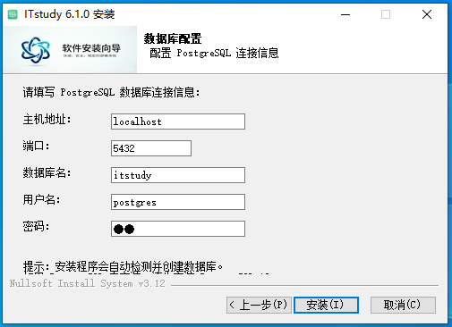

# PostgreSQL 安装指南（Windows · 小白版）

> **这篇文档解决什么问题？** ITstudy 的所有数据（学生、成绩、作业、课件记录……）都存放在
> PostgreSQL 数据库里。所以装 ITstudy 之前，要先装好 PostgreSQL。
>
> **你只需要做三件事**：下载安装 → 记下 5 个连接信息 → 回到
> [README 的安装教程](../README.md#三安装教程) 安装 ITstudy。数据库本身不用手动创建，
> ITstudy 安装程序会自动建好。

适用版本：ITstudy `V6.1.1` ｜ 推荐 PostgreSQL `12` 或更高版本

---

## 一、安装前先准备一张纸

安装 PostgreSQL 的过程中，你会设置一个密码，并看到几个连接参数。
**请把下面 5 项抄在纸上或记事本里**，安装 ITstudy 时原样填入：

| 要记录的信息 | 常见值 | 说明 |
|---|---|---|
| **主机地址** | `localhost` | 数据库装在哪台电脑。装在本机就填 `localhost`；装在另一台服务器就填那台服务器的 IP |
| **端口** | `5432` | PostgreSQL 的“门牌号”。安装时没改过就是 `5432` |
| **数据库名** | `itstudy` | 存 ITstudy 数据的库名。安装程序会自动创建，不用你手动建 |
| **用户名** | `postgres` | PostgreSQL 的超级管理员账号，安装时默认就是它 |
| **密码** | **你自己设置的密码** | 安装 PostgreSQL 时让你设置的那个密码，**最重要，千万别忘** |

> 安装 ITstudy 时出现的“数据库配置”窗口，就是让你填这 5 项：
>
> 
>
> 图中“密码”是圆点，代表你安装 PostgreSQL 时设置的密码。把这张图里的 5 项
> 提前记好，安装时照着填即可。

---

## 二、下载并安装 PostgreSQL

### 1. 下载

打开 PostgreSQL 官方 Windows 下载页：

<https://www.postgresql.org/download/windows/>

下载 `.exe` 安装包（一般选最新稳定版即可；学校机房也可以使用 12～18 的任一稳定版本）。

### 2. 安装（关键步骤只有 4 个）

双击安装包，大部分页面直接“下一步”，重点注意这 4 处：

1. **设置密码（Password）**
   - 这是 `postgres` 超级用户的密码。
   - 自己设一个记得住的强密码，并**立刻记到纸上**。
   - 这个密码就是上文表格里的“密码”，ITstudy 安装时会用到。
2. **端口（Port）**
   - 保持默认 `5432`。
   - 如果提示端口被占用，可以改成 `5433`，但一定要记下来，安装 ITstudy 时端口也要改成 `5433`。
3. **区域设置（Locale）**
   - 保持默认 `Default locale` 即可。
4. **Stack Builder**
   - 取消勾选（这是附加组件，ITstudy 用不到）。

安装完成后，PostgreSQL 会自动作为 Windows 服务在后台运行，不需要每次手动启动。

### 3. 确认装好了

打开 PowerShell（按 Win 键，输入 `powershell`，回车），执行：

```powershell
psql --version
```

看到类似 `psql (PostgreSQL) 18.4` 就说明装好了（版本号可能不同，能显示即可）。

再检查数据库是否在线：

```powershell
pg_isready -h localhost -p 5432
```

看到 `localhost:5432 - accepting connections` 就说明数据库正在运行。

> 如果提示“psql 不是内部或外部命令”，说明 PostgreSQL 的 `bin` 目录没有加入 PATH，
> 按下面第三节处理。

---

## 三、把 PostgreSQL 加入 PATH（命令不可用时才做）

1. 在开始菜单搜索“编辑系统环境变量” → 打开“环境变量”。
2. 在“系统变量”里找到 `Path` → 编辑 → 新增一行：
   ```
   C:\Program Files\PostgreSQL\18\bin
   ```
   > 这里的 `18` 要换成你实际安装的版本号，例如 `16`、`17`。
3. 一路“确定”保存，**重新打开** PowerShell 再试 `psql --version`。

---

## 四、创建数据库（通常不用做）

ITstudy 启动或安装时会**自动检测并创建**名为 `itstudy` 的数据库，所以绝大多数人
**不用手动建库**。

只有在你需要提前建库、或安装程序提示数据库不存在时，才任选一种方式：

### 方式 A：用 pgAdmin（鼠标操作）

1. 开始菜单搜索并打开 **pgAdmin**。
2. 用 `postgres` 账号和密码登录。
3. 左侧展开服务器 → 右键 `Databases` → `Create` → `Database`。
4. 名称填 `itstudy`，点 `Save`。

### 方式 B：用命令行（熟悉命令的人）

```powershell
psql -U postgres -h localhost -p 5432
# 输入安装时设置的密码，进入 psql 后执行：
CREATE DATABASE itstudy;
\q
```

---

## 五、ITstudy 怎么使用这 5 个信息

安装 ITstudy 时，安装向导会弹出“数据库配置”窗口（见本文开头的截图），
把纸上记录的 5 项填进去即可：

| 安装窗口里的字段 | 填什么 |
|---|---|
| 主机地址 | 一般为 `localhost` |
| 端口 | 一般为 `5432` |
| 数据库名 | 一般为 `itstudy` |
| 用户名 | 一般为 `postgres` |
| 密码 | 你安装 PostgreSQL 时设置的密码 |

安装程序会自动检测数据库、创建 `itstudy` 库并建表，不需要你提前建库。

> 如果安装的是“项目文件夹直接运行”方式，连接信息也可以写在项目根目录的
> `postgresql.txt` 里，或通过环境变量 `DB_HOST` / `DB_PORT` / `DB_NAME` /
> `DB_USER` / `DB_PASS` 指定。优先级：环境变量 > `postgresql.txt` > 默认值。

---

## 六、备份与恢复（重要）

ITstudy 的数据由两部分组成：**数据库 + 上传文件**。只备份数据库，恢复后附件、
课件、作业文件会丢失。完整备份方法见
[README · 备份（很重要）](../README.md#44-备份很重要)。

单说数据库，备份和恢复命令如下：

```powershell
# 备份：把 itstudy 库导出为 backup.sql
pg_dump -h localhost -p 5432 -U postgres -d itstudy --no-owner --no-acl > backup.sql

# 恢复：先停掉 ITstudy 服务，再执行
psql -U postgres -d itstudy < backup.sql
```

> 执行命令时会提示输入 `postgres` 密码。备份文件建议放在另一块磁盘或另一台电脑上。

---

## 七、忘记 postgres 密码怎么办？

> ⚠️ 下面的 `trust` 方式只是**临时**让人免密登录，改完密码后必须改回
> `scram-sha-256`，否则局域网内任何人都能免密访问你的数据库。

1. 找到 `pg_hba.conf`，默认在：
   `C:\Program Files\PostgreSQL\18\data\pg_hba.conf`
2. 把 `host ... all all 127.0.0.1/32 scram-sha-256` 这一行的
   `scram-sha-256` 临时改成 `trust`。
3. 以管理员身份重启 PostgreSQL 服务：
   ```powershell
   net stop postgresql-x64-18
   net start postgresql-x64-18
   ```
4. 免密登录并改密码：
   ```powershell
   psql -U postgres -h localhost -p 5432
   ALTER USER postgres PASSWORD '新的强密码';
   \q
   ```
5. **把 `pg_hba.conf` 改回 `scram-sha-256`**，再次重启服务。
6. 别忘了同步修改 ITstudy 的连接信息（安装目录的 `postgresql.txt` 或环境变量
   `DB_PASS`），然后重启 ITstudy。

> 忘记的是 **ITstudy 管理员账号密码**（不是数据库密码）？在项目目录运行：
> ```powershell
> python tools/reset_admin_password.py
> ```
> 它会生成一个新密码并打印出来；也可以加 `--password 你的新密码` 直接指定。

---

## 八、常见问题

### Q1：安装时提示端口 5432 被占用

先看是谁占用了端口：

```powershell
netstat -ano | findstr :5432
```

如果确实被别的程序占用，可以在安装 PostgreSQL 时改成 `5433`，并记住这个端口；
安装 ITstudy 时端口也填 `5433`。

### Q2：`pg_dump` / `psql` 命令找不到

PostgreSQL 的 `bin` 目录没加入 PATH，按本文第三节添加，然后重开终端。

### Q3：恢复数据库后新增记录报“主键冲突”

正常用 `pg_dump` 全量恢复不会出现；只有手工复制数据后才可能遇到。
可把自增序列校准到当前最大值（以 `student` 表为例）：

```sql
SELECT setval('student_id_seq', (SELECT max(id) FROM student));
```

### Q4：需要把数据库开放给局域网其他电脑

默认只监听本机。若 ITstudy 和数据库不在同一台电脑，需要修改 PostgreSQL 的
`postgresql.conf`（`listen_addresses = '*'`）并在 `pg_hba.conf` 中允许对应网段，
修改后重启服务。**这会扩大数据库的访问范围，请同时设置强密码并限制防火墙来源。**

---

## 九、进阶（普通用户可跳过）

### 服务管理

```powershell
Get-Service postgresql-x64-18          # 查看状态
net start postgresql-x64-18            # 启动（管理员）
net stop postgresql-x64-18             # 停止（管理员）
```

> 服务名里的 `18` 随安装版本变化，可在“服务”管理器里确认实际名称。

### 连接池 pgBouncer（高并发才需要）

单间机房/一所学校通常不需要。确需使用时，可把 ITstudy 的数据库端口指向
pgBouncer（默认 `6432`）。注意 pgBouncer 的事务模式不支持 session 级临时表。

### 性能参数（数据量大了再考虑）

| 参数 | 建议值 | 作用 |
|------|--------|------|
| `shared_buffers` | 256MB～512MB | 数据库内存缓冲区，别超过物理内存的 1/4 |
| `effective_cache_size` | 1GB～2GB | 告诉数据库系统缓存大概有多大 |
| `work_mem` | 16MB | 单个排序/聚合可用的内存 |
| `maintenance_work_mem` | 128MB | 建索引、清理等维护操作的内存 |

在 `postgresql.conf` 中修改，重启 PostgreSQL 后生效。默认配置已能正常运行，
不建议新手一开始就调。
